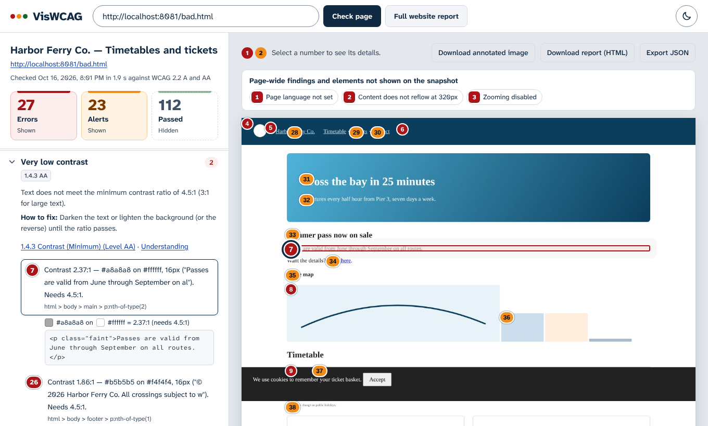
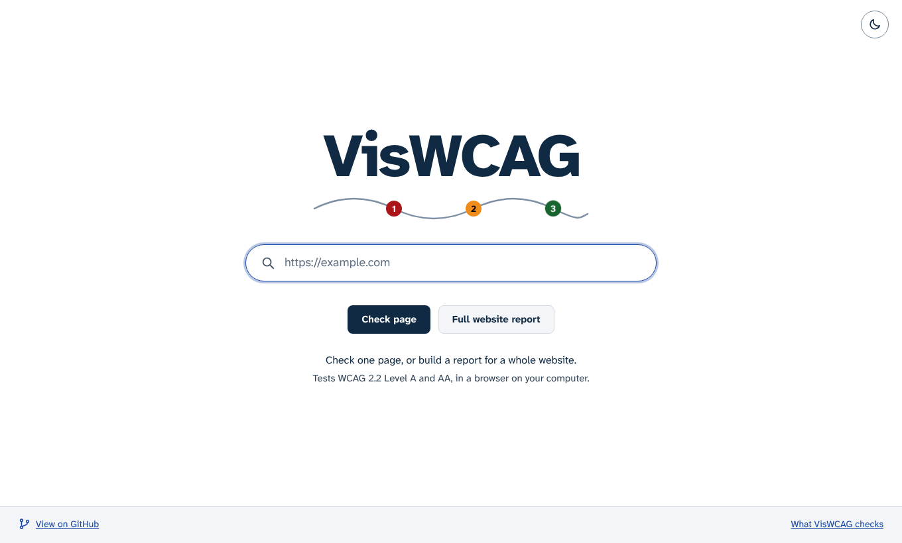
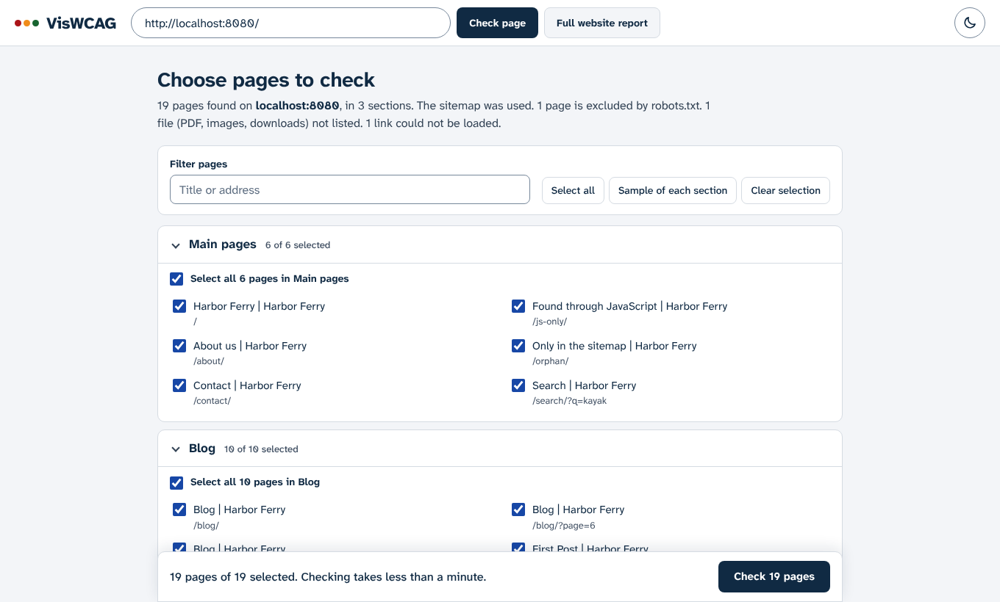
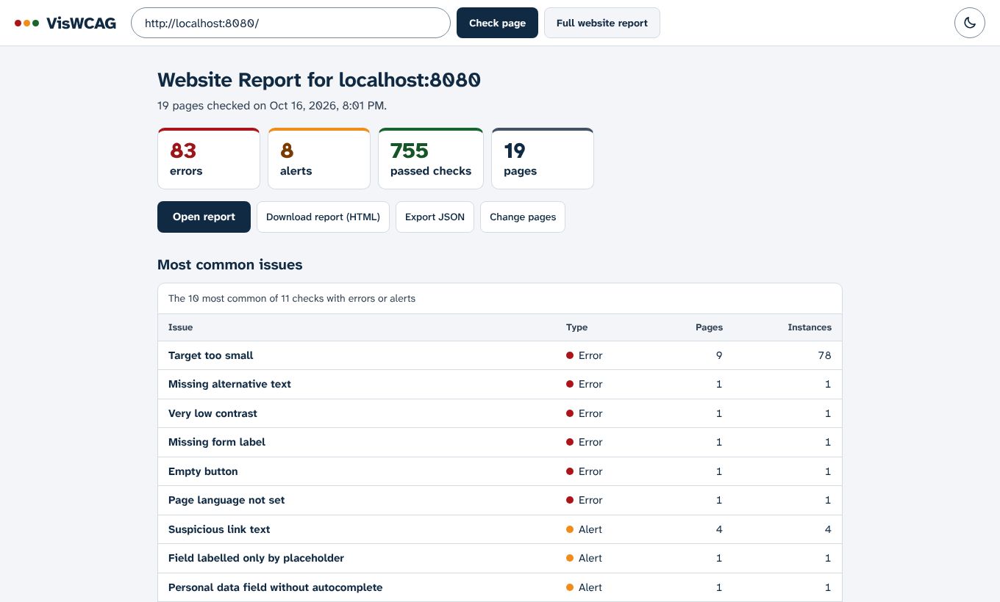
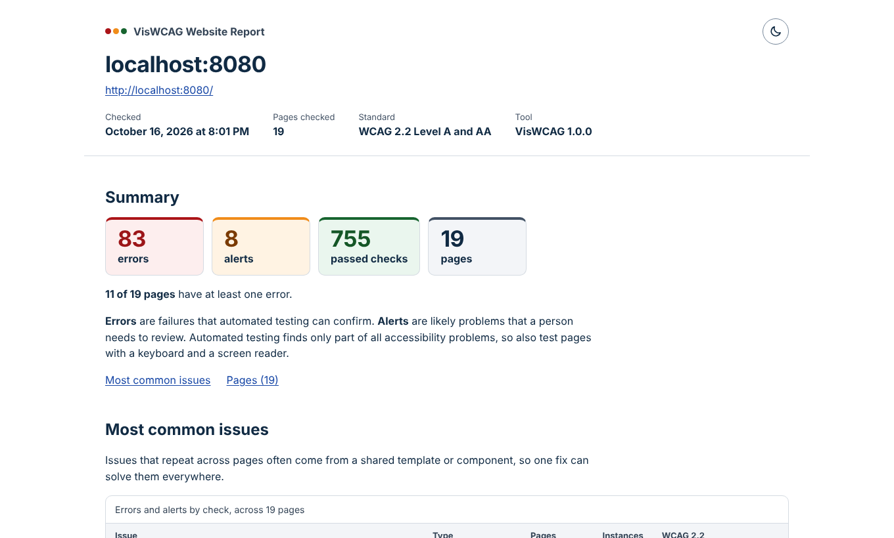
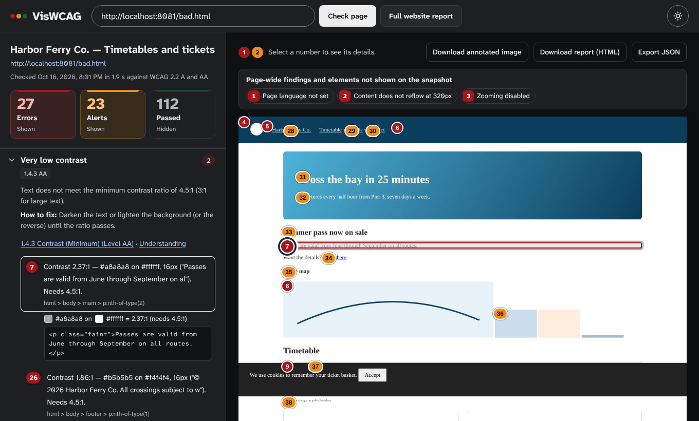

# VisWCAG

**An open-source accessibility checker that tests web pages against WCAG 2.2 and marks every finding on a snapshot of the page.** It runs on your own computer: enter an address, and VisWCAG loads the page in a local headless Chrome, checks the rendered page, and shows each result twice: in a list grouped by check, and as a numbered marker on the page.

[](LICENSE)




> VisWCAG is inspired by WebAIM's WAVE and is an independent project, not affiliated with WebAIM.

## Contents

- [Features](#features)
- [Quick start](#quick-start)
- [Using VisWCAG](#using-viswcag)
- [What it checks](#what-it-checks)
- [How it works](#how-it-works)
- [Configuration](#configuration)
- [Security](#security)
- [Limitations](#limitations)
- [Development](#development)
- [Contributing](#contributing)
- [Acknowledgements](#acknowledgements)
- [License](#license)

## Features

- **WCAG 2.2 Level A and AA**: 66 checks for errors and alerts, including the new 2.2 criteria Target Size, Focus Not Obscured, Accessible Authentication and Dragging Movements. Every result names its success criterion and links to the specification and its Understanding document.
- **Three result types**: **errors** (red) that automated testing can confirm, **alerts** (orange) that need a person to judge, and **passed** checks (green, hidden by default) so you can see what was tested.
- **Annotated snapshot**: a full-page screenshot with a numbered marker on every finding. Select a marker to open its details, or select a result to highlight its element.
- **Full website report**: finds a site's pages (sitemap, links, `robots.txt` respected), groups them into sections, lets you choose which to check, and combines them into one report with the most common issues across pages.
- **Shareable reports**: self-contained HTML reports (one page or a whole website) that work offline, follow the reader's light or dark setting, and print cleanly. Also: annotated PNG and JSON export.
- **Runs locally**: pages are loaded by a browser on your computer, so `localhost`, intranet pages and `file://` URLs work. Results stay on your computer, and the interface itself loads nothing from other sites.
- **Accessible itself**: keyboard and screen reader friendly, light and dark themes with AAA text contrast, and VisWCAG's own pages and reports pass its checks.
- **Command line**: `npx viswcag <url>` for scripts and CI.

## Quick start

Requirements: **Node.js 22.12 or later**. `npm install` also downloads a copy of Chrome for Puppeteer (about 170 MB, once).

```bash
git clone https://github.com/5hachaf/viswcag.git
cd viswcag
npm install
npm start
```

Open <http://127.0.0.1:4321>, enter a web address and choose **Check page** or **Full website report**.

To use a Chrome or Chromium you already have instead of downloading one, set `PUPPETEER_SKIP_DOWNLOAD=1` before `npm install` and `CHROME_PATH=/path/to/chrome` before `npm start`.

## Using VisWCAG



### Check a page

Enter an address and choose **Check page**. VisWCAG loads the page, waits for it to settle, scrolls it to load lazy content, runs the checks and takes a snapshot. Progress is shown step by step.

- The **counters** (Errors, Alerts, Passed) show or hide each result type, in the list and on the snapshot.
- Results are **grouped by check**. Each group explains the problem, how to fix it, and links to the WCAG criterion. Each result shows its message, the element's CSS selector and its HTML; contrast results include colour swatches and the measured ratio.
- **Numbered markers** on the snapshot are buttons: select one (or Tab to it and press Enter) to open its result in the list. Selecting a result outlines its element on the snapshot.
- Findings without a position, such as a missing page language, appear as chips above the snapshot.

Above the snapshot are three downloads:

| Download | What you get |
| --- | --- |
| **Download annotated image** | The snapshot as a PNG with outlines and numbered markers for the result types currently shown. |
| **Download report (HTML)** | A single self-contained file to share or print: summary, annotated snapshot, and every error and alert grouped by check, with WCAG references, fixes, locations and code. Markers link to their details, and each finding links back to its marker. |
| **Export JSON** | All results, including passes, for other tools (see [Result format](#result-format)). |

### Full website report

Choose **Full website report** to check many pages of one site together.

1. **Finding pages.** VisWCAG reads `robots.txt` and the sitemap, opens the start page in Chrome so menus built with JavaScript count, then follows links on the same site with [Crawlee](https://crawlee.dev/). It respects `robots.txt` and `rel="nofollow"`, and skips other sites, files (PDF, images, downloads), logout links, tracking parameters and more than five query-string variants of one page. It stops at 300 pages; you can stop sooner and choose from what was found.
2. **Choosing pages.** Pages are grouped into sections by address: `/blog/…` becomes **Blog**, one-off pages such as `/about` go into **Main pages**, and language prefixes such as `/en/` and `/fr/` are kept apart. Filter the list, select whole sections, or use **Sample of each section**: pages built from the same template usually share the same issues. Sites with up to 25 pages start fully selected; larger sites start with a sample.

   

3. **Checking.** The chosen pages are checked two at a time, with progress page by page. You can stop and make the report from the pages already checked.
4. **Overview.** Totals, the most common issues across pages, and every page with its counts. Open any page to see its full results and snapshot; the browser's Back button returns to the overview. **Change pages** returns to the list, and pages already checked are not checked again.

   

**Open report** shows the website report in a new tab and **Download report (HTML)** saves it. It has the same design as the single-page report: a summary, the most common issues (often one fix in a shared template solves them everywhere), the pages by section, any pages that could not be checked, then each page with its annotated snapshot, errors and alerts. When printed, each page starts on a new sheet.



### Themes

The interface and the reports follow your system's light or dark setting. The sun and moon button switches theme and remembers the choice; switching back to the theme your system uses returns to following the system. Reports always print in light colours.



### Command line

```bash
npx viswcag https://example.com                      # summary of errors and alerts
npx viswcag https://example.com --json               # full JSON result (without the image)
npx viswcag https://example.com --snapshot page.jpg  # also save the page snapshot
```

The exit code is `1` when errors are found (`--no-fail` turns this off) and `2` when the page could not be checked, so it can gate a build.

## What it checks

The running app lists every check at `/rules`; the source is [`src/engine/rules.js`](src/engine/rules.js).

| WCAG 2.2 success criterion | Checks |
| --- | --- |
| 1.1.1 Non-text Content | missing, suspicious, redundant or overlong alt text; linked images; image buttons; image-map areas; SVG `role="img"`; embedded objects |
| 1.2.1, 1.2.2 Media | video without a captions track, embedded players, audio that needs a transcript |
| 1.3.1 Info and Relationships | form labels, orphaned and empty labels, headings (empty, skipped levels, missing H1, text styled as a heading), lists, tables, radio groups, fieldset legends, landmarks, duplicate ids that a label or ARIA attribute refers to |
| 1.3.5 Identify Input Purpose | invalid `autocomplete` values, personal-data fields without `autocomplete` |
| 1.4.2 Audio Control | media that plays automatically with sound |
| 1.4.3 Contrast (Minimum) | 4.5:1 for normal text, 3:1 for large text |
| 1.4.4 Resize Text | zoom blocked by the viewport meta tag, text under 10 px |
| 1.4.10 Reflow | horizontal scrolling at a 320 CSS px viewport |
| 2.2.1, 2.2.2 | `meta refresh`, `marquee`, `blink` |
| 2.4.1 Bypass Blocks | skip links (and broken ones), landmarks, headings |
| 2.4.2 Page Titled | missing title |
| 2.4.3 Focus Order | positive `tabindex` |
| 2.4.4 Link Purpose | empty links, "click here" style link text, redundant adjacent links |
| 2.4.7 Focus Visible | focuses each control and compares its styles before and after |
| 2.4.11 Focus Not Obscured (Minimum) · *new in 2.2* | focuses each control as keyboard navigation would and reports it when a fixed or sticky element covers it completely |
| 2.5.3 Label in Name | `aria-label` that leaves out the visible label |
| 2.5.7 Dragging Movements · *new in 2.2* | alerts on draggable elements and custom sliders, for a person to confirm a single-pointer alternative |
| 2.5.8 Target Size (Minimum) · *new in 2.2* | targets under 24 × 24 CSS px that fail the 24 px circle spacing test; links within text, unstyled browser controls and content clipped by scroll areas are excluded |
| 3.1.1, 3.1.2 Language | missing or invalid `lang` |
| 3.3.2 Labels or Instructions | fields labelled only by `title` or `placeholder` |
| 3.3.8 Accessible Authentication (Minimum) · *new in 2.2* | password and one-time-code fields that block pasting (error) or set `autocomplete="off"` (alert) |
| 4.1.2 Name, Role, Value | empty buttons, invalid roles, missing required ARIA states, broken `aria-labelledby`, focusable content inside `aria-hidden`, untitled iframes, nested interactive controls, duplicate ids (an alert when nothing refers to them) |

### WCAG 2.2 notes

- **4.1.1 Parsing was removed** in WCAG 2.2. A duplicate id is an error only when a `<label for>` or an ARIA attribute points at it (under 1.3.1 and 4.1.2); other duplicate ids are alerts.
- **3.2.6 Consistent Help** and **3.3.7 Redundant Entry** cannot be tested automatically; the `/rules` page lists them for manual review along with how far each new criterion is covered.
- **Target Size** is strict about small links that sit side by side with only a space between them, such as unstyled navigation menus. That is what the criterion requires, so expect these to show up on many sites.
- Criteria names, levels and links live in [`src/engine/wcag.js`](src/engine/wcag.js).

## How it works

VisWCAG inspects the **rendered DOM**, after CSS has been applied and JavaScript has run, not the HTML the server sends.

```
Browser interface (public/)  ──HTTP──▶  Local server (server.js)
                                           │
              ┌────────────────────────────┴───────────────────────────┐
              ▼                                                        ▼
  Page check (src/scanner.js)                          Page discovery (src/crawler.js)
  Headless Chrome via Puppeteer                        robots.txt, sitemap, Chrome-rendered
   1. load the page, wait for the network               start page, then Crawlee over HTTP
   2. scroll to load lazy content                       → pages grouped into sections
   3. inject src/engine/engine.browser.js
   4. run the checks on the live DOM
   5. full-page snapshot (JPEG)
   6. keyboard focus checks (2.4.7, 2.4.11)
   7. reflow check at 320 px
```

- The engine walks the whole DOM, including **open shadow roots** and **same-origin iframes**, and works out accessible names, roles, visibility and computed styles. It is plain browser JavaScript with no dependencies, so you can paste it into DevTools and run `__viswcag.scan()` on any page.
- **Contrast** uses the WCAG relative-luminance formula and blends semi-transparent backgrounds and opacity up the ancestor chain. Text over images or gradients becomes an alert.
- Each result records its element's position, so markers line up with the snapshot. Markers are placed so they do not overlap at any window size.
- The server streams progress as newline-delimited JSON, so the interface can show each step.

### Result format

`POST /api/scan` and the JSON export use this shape (abbreviated):

```js
{
  url, finalUrl, status, title, lang, scannedAt, durationMs,
  engine: { name: 'VisWCAG', version, standard: 'WCAG 2.2' },
  counts: { error, alert, pass },
  snapshot: { dataUrl, width, height, docHeight, truncated },
  results: [{
    id,                // 1, 2, 3… (errors first, then alerts, then passes)
    type,              // 'error' | 'alert' | 'pass'
    rule,              // key in src/engine/rules.js, e.g. 'contrast'
    message, selector, snippet,
    rect,              // { x, y, w, h } in snapshot pixels, or null for page-wide results
    extra              // rule-specific data, e.g. contrast { ratio, required, fg, bg }
  }],
  rules, wcag          // the rule catalogue and WCAG criteria used
}
```

Result numbers are only valid within one scan; to compare scans, match on `rule` and `selector`.

## Configuration

Set these as environment variables before `npm start`:

| Variable | Default | Purpose |
| --- | --- | --- |
| `PORT` | `4321` | Server port |
| `HOST` | `127.0.0.1` | Address to listen on (see [Security](#security)) |
| `CHROME_PATH` | Puppeteer's Chrome | Use an existing Chrome or Chromium |
| `VISWCAG_CONCURRENCY` | `2` | Pages checked at the same time |
| `VISWCAG_NO_SANDBOX` | unset | Start Chrome with `--no-sandbox` (needed in some containers; automatic when running as root) |
| `VISWCAG_CRAWL_MAX_PAGES` | `300` | Pages to find before page discovery stops |
| `VISWCAG_SITE_MAX_PAGES` | `200` | Pages allowed in one website report |

## Security

VisWCAG is designed to run on your own computer. The server listens on `127.0.0.1` and will load **any** address it is given, including `file://` paths and addresses on your local network. That is what makes it useful for local development, and also why it should not be exposed as a public service as it is. Before hosting it for others you would need, at a minimum, to block `file://` and private network addresses (including redirects), add rate limits, and run Chrome with its sandbox in an isolated container.

## Limitations

Automated testing finds only part of all accessibility problems: VisWCAG can tell that an image has alt text, not whether the text is accurate. Use it alongside manual testing with a keyboard and a screen reader.

- Cross-origin iframes are not inspected (browser security).
- Pages behind a login are not reachable, since each check starts a fresh browser session.
- States that appear only after interaction, such as menus and dialogs, are not opened automatically.
- Page discovery reads links over plain HTTP after the start page, so pages reachable only through JavaScript navigation deeper in a site are not found.
- Snapshots are 1280 px wide and stop at 15,000 px tall (10,000 px in website reports); results further down are listed but not marked.
- Target Size cannot detect its *Equivalent* and *Essential* exceptions; Focus Not Obscured tests the page as it first loads.

## Development

```
server.js                     Express server and streaming API
bin/viswcag.js                Command-line scanner
src/scanner.js                Puppeteer: load, inject engine, snapshot, focus and reflow checks
src/crawler.js                Page discovery (robots.txt, sitemap, Crawlee) and sections
src/engine/engine.browser.js  In-page check engine (plain browser JavaScript)
src/engine/rules.js           Rule catalogue: type, WCAG criteria, explanation, fix
src/engine/wcag.js            WCAG 2.2 criteria, links and 2.2 coverage notes
public/index.html, app.js     Home page and single-page results
public/site.js                Full website report screens
public/report.js              Builds the single-page and website HTML reports
public/theme.js, app.css      Light and dark themes, styles
public/rules.html             "What VisWCAG checks" page
test/run.js                   Test suite
test/site-server.js           Serves the test website
test/fixtures/                Test pages and a small test website
docs/screenshots/             Images used in this README
```

### Tests

```bash
npm test
```

The suite needs Chrome (Puppeteer's, or `CHROME_PATH`) and covers:

- `test/fixtures/bad.html`, a deliberately inaccessible page: every planted problem, including the WCAG 2.2 cases, must be reported with the right type.
- `test/fixtures/good.html`: must produce no errors or alerts.
- `test/fixtures/site/`, a small website with a sitemap, a `robots.txt`-blocked folder, a JavaScript-built link, files, external links and query-string variants: the crawler must find exactly the right pages and sections.
- The crawl and website-check endpoints, including stopping a crawl and a page that cannot load.
- Both HTML reports: every id is unique and every in-page link has a target.

### Adding a check

1. Add the rule to [`src/engine/rules.js`](src/engine/rules.js) with its `type`, `title`, `sc` (WCAG criteria), `summary` and `fix`. Add any new criterion to [`src/engine/wcag.js`](src/engine/wcag.js).
2. In [`src/engine/engine.browser.js`](src/engine/engine.browser.js), call `report('your_rule', element, message)` from the matching section of `scan()`. Use `null` as the element for page-wide results.
3. Plant an example in `test/fixtures/bad.html`, add the rule to the expectations in `test/run.js`, and check `good.html` stays clean.
4. Restart the server: the engine is read once at startup. Interface changes only need a browser refresh.

To debug a check on a real site, open the site in Chrome, paste the contents of `engine.browser.js` into the DevTools console, and run `__viswcag.scan().results`.

## Contributing

Issues and pull requests are welcome. Please include a test case for any new or changed check, run `npm test` before opening a pull request, and keep the interface keyboard and screen reader accessible. VisWCAG should pass its own checks: run it against its home page, the `/rules` page and a generated report.

## Acknowledgements

- [WCAG 2.2](https://www.w3.org/TR/WCAG22/) and its Understanding documents, by the W3C Web Accessibility Initiative.
- [WAVE](https://wave.webaim.org/) by WebAIM, the inspiration for showing results on the page itself.
- [Puppeteer](https://pptr.dev/), [Crawlee](https://crawlee.dev/) and [Express](https://expressjs.com/).
- The [Atkinson Hyperlegible](https://www.brailleinstitute.org/freefont/) typefaces by the Braille Institute, served locally from [Fontsource](https://fontsource.org/) (SIL Open Font License).

## License

[MIT](LICENSE)
